<div align="center">


# Argus

**Self-hosted uptime and Docker monitoring for a single host.**
Two small Go services, one Postgres, and a dashboard that refuses to make numbers up.

</div>


## Contents

- [What it is](#what-it-is)
- [The rule that shapes everything](#the-rule-that-shapes-everything)
- [How it works](#how-it-works)
- [What you get](#what-you-get)
  - [Outage history with real durations](#outage-history-with-real-durations)
  - [A per-container page that admits what it doesn't know](#a-per-container-page-that-admits-what-it-doesnt-know)
  - [Alert history you can actually narrow down](#alert-history-you-can-actually-narrow-down)
  - [Log lines that match your rules](#log-lines-that-match-your-rules)
  - [Charts that keep their gaps](#charts-that-keep-their-gaps)
  - [Host resources in the sidebar](#host-resources-in-the-sidebar)
  - [A mascot that tells you the mood before you read a number](#a-mascot-that-tells-you-the-mood-before-you-read-a-number)
  - [Details that matter at 3am](#details-that-matter-at-3am)
- [Getting started](#getting-started)
  - [1. Start Argus](#1-start-argus)
  - [2. Tell Argus what to watch](#2-tell-argus-what-to-watch)
  - [3. Open the dashboard from another machine](#3-open-the-dashboard-from-another-machine)
  - [What Argus can touch](#what-argus-can-touch)
- [Alerts](#alerts)
- [Configuration](#configuration)
- [Deliberately not in this version](#deliberately-not-in-this-version)
- [Under the hood](#under-the-hood)
- [License](#license)

## What it is

Argus watches one machine and answers three questions: *is my service responding*, *are my containers staying up*, and *what happened while I wasn't looking*.

It is built for the case where Prometheus + Grafana + Alertmanager is three services too many — a single VPS running a handful of containers. You label the containers you care about, point Argus at a health-check URL, and get a dashboard plus Telegram alerts. No agents, no exporters, no query language.

Everything it knows comes from four sources: HTTP health checks it performs itself, the Docker event stream, the logs of the containers it watches, and the host's own counters for CPU, memory and disk. Nothing is inferred or smoothed.


## The rule that shapes everything

**Only what is actually in the data reaches the screen.** A monitoring tool that shows a plausible number in place of a missing one is worse than a broken one, so Argus doesn't:

| Situation | What Argus shows | What it refuses to show |
| --- | --- | --- |
| An hour with no checks | a gap in the chart | a zero, drawn as if latency were 0 ms |
| A target that has never been checked | `—` | `100% uptime` |
| A container that went down, came back, but the return was never recorded | `return not recorded`, duration `—` | a downtime counter that keeps growing |
| An empty database | empty states in every block | demo numbers |

The same rule applies to sums: the outage summary adds up only the intervals it could actually measure, and says out loud how many it couldn't.

## How it works

```
    HTTP health checks   Docker events         container logs
    (GET, every 60s)     (die / oom / kill /   (stdout, stderr,
            │             restart / start …)    regex rules)
            │                    │                   │
            ▼                    ▼                   ▼
    ┌──────────────────────────────────────────────────┐
    │  collector  (argus-backend)       REST API :8099 │
    │  prober · watcher · matcher · alerter · cleaner  │
    └──────────────────────────────────────────────────┘
            │                              │
            ▼                              ▼
       PostgreSQL                    Telegram bot
            │
            │  /v1/api/…  (reads; creates and deletes uptime targets)
            ▼
    ┌──────────────────────────────────────────────────┐
    │  dashboard  (argus-frontend)  :8088              │
    │  htmx · Alpine · Chart.js on Go templates         │
    └──────────────────────────────────────────────────┘
```

**The collector** owns everything that writes.

- The *prober* sends a `GET` to every probe target every 60 seconds and records latency and outcome; a response under HTTP 300 counts as up. One failed check doesn't page anyone: the target goes down after `failure_threshold` failures in a row (2 by default), and the first successful check brings it back up.
- The *watcher* subscribes to the Docker event stream and records container lifecycle events as they happen — no polling, no missed restarts. It also notices a crash loop: 5 exits within 5 minutes by default.
- The *matcher* follows the output of every watched container and records the lines that match your rules.
- The *alerter* groups new alerts by target, sends one Telegram message per target, and marks them as sent.
- The *cleaner* deletes probes, events and log matches older than 14 days, once a day. Alerts are kept.
- The *host sampler* reads CPU, memory and root-disk usage every 15 seconds and raises an alert when memory or disk climbs past a threshold.

**The dashboard** is a separate process that talks to the collector over its own REST API. It reads everything it shows, and its only writes are creating and deleting uptime targets. It holds no state and can be restarted or rebuilt while the collector keeps recording. If the collector is down, the dashboard says so instead of showing stale numbers as if they were live.

The two processes share nothing but the API. Start them in any order.

## What you get

### Outage history with real durations

Argus doesn't store "incidents" — it reconstructs them on read from probe results and Docker events. A run of failed checks becomes one outage; a `die` closed by a `start` becomes one outage with a measured duration. One stop of a container is one outage, even though Docker reports it as a `kill` and a `die` a second apart.

They live under *History → Outages*, with totals on top: how many outages there were, how much downtime was actually measured, and the longest one.



### A per-container page that admits what it doesn't know

The 24-hour bar shows measured outages. Its background is deliberately neutral, not green: Docker only reports failures, so a quiet stretch means *no events were recorded*, which is not the same as proof the container was up. Below the bar, every outage is listed with its cause and duration, because a seven-minute outage is 0.5% of a day and unreadable on any bar.


The same page has the container's Docker events per hour, the raw event list, and the log lines it matched. Click a container in the sidebar and you land there. Containers that need attention sort above the calm ones.

A container that crashed and came back on its own shows as *degraded* for 15 minutes, and its card says when that clears. A crash is an exit with a non-zero code or an OOM kill. Stops you asked for (`docker stop`, `docker restart`, `docker compose up` recreating a container) don't count: Docker reports them as a `kill` right before the exit, so they neither turn the card yellow nor raise an alert.


### Alert history you can actually narrow down

*History → Alerts* filters by target type (uptime or container) and severity. Filters are links, so a filtered view has its own URL, and the list swaps in place without a reload. Critical and error alerts from the last hour are drawn as dark rows so they stand out; everything older gets a thin border in its severity colour. The list is paged 50 rows at a time, and only the first page refreshes itself, so older rows never slide away under the cursor. An empty result says "No alerts" and admits it can't tell whether the filter matched nothing or nothing was recorded yet.


### Log lines that match your rules

The matcher follows stdout and stderr of every watched container and checks each new line against a list of regular expressions from the collector's config. A line that matches is stored verbatim with the rule's severity and raises an alert — `Log line matched rule "panic|FATAL"` — which goes to Telegram like any other.

```yaml
matcher:
  rules:
    - pattern: "panic|FATAL"            # Go regexp
      severity: critical                # critical / error / warning / info / debug
      container: "*"                    # every watched container
    - pattern: "(?i)connection refused"
      severity: error
      container: "argus-db"             # or one container, by name
```

Only new lines are read: Argus doesn't rescan old logs on startup. If the log stream drops, the matcher reconnects and resumes from the last line it saw, so a reconnect neither repeats nor skips a line. A container that starts later is picked up as soon as Docker reports the `start`.

The overview counts matched lines over the last 24 hours, and the count feeds the mascot: one or two matches and Argus is watching, five or more and it's angry. Each container's page shows its own matches. *History → Log matches* has hourly bars split by severity, a container filter, severity chips, and every matched line as it was written, 50 per page.



### Charts that keep their gaps

Latency p95 and uptime across all probe targets, Docker events per hour for a single container, and log matches per hour split by severity. The charts are the one part of the page htmx never replaces — points arrive as JSON and datasets update in place, so tooltips and animation survive.


### Host resources in the sidebar

CPU, RAM and the root partition, refreshed every 10 seconds:

| Meter | What it measures |
| --- | --- |
| CPU | share of time the host wasn't idle between the last two samples |
| RAM | `MemTotal − MemAvailable`, so page cache counts as free, the way the kernel sees it |
| Disk | the root partition, counted as `df` counts it, blocks reserved for root left out |

A bar turns yellow at 90% and red at 95%, once the level has held for three samples in a row, so a one-off spike doesn't paint it. The same rise raises a Telegram alert for memory and disk, once per rise: `Disk usage is 93% (warning above 90%)`. Nothing is sent when usage goes back down. CPU is shown but never alerts: a busy CPU is usually fine.

Until the second sample there's no CPU figure, only `—`. A collector too old to report host metrics gets a note saying so instead of empty bars.

### A mascot that tells you the mood before you read a number

<p>


</p>

The mood comes from the same data as everything else, and the loudest signal wins:

| Mood | When |
| --- | --- |
| All quiet | every target is up, no alerts, no log matches in 24 hours |
| Watching | 1–2 log matches in 24 hours |
| Something's off | a container crash in the last 15 minutes, a failed check in 24 hours, a warning alert, or 3–4 log matches |
| Critical failure | a target is down, a critical alert in 24 hours, or 5+ log matches |
| Asleep | nothing to watch yet, or no answer from the collector |

Asleep never means all is well. Next to the mood, the card says which signal chose it: `web-frontend is down`, `3 log matches in 24h`.

### Details that matter at 3am

- **Live without reloads.** Every panel re-fetches itself and swaps in place: every 10 seconds for live numbers, every 15–30 seconds for history lists. A chip in the header shows the age of the data, pauses polling when you click it, and says `lost connection to server` when requests start failing.
- **Only real changes flash.** A panel that swapped identical content stays still, so a blinking screen always means something actually changed.
- **Works offline.** htmx, Alpine, Chart.js and both fonts are vendored into the binary. The dashboard opens on a host with no internet.
- **Dark and light.** The theme is resolved by an inline script before first paint, so the page never flashes the wrong palette.
- **Honest failure.** When the collector is unreachable, pages show a waiting screen that checks back every 5 seconds and reloads itself once the collector answers. Panels already on screen keep the last live data instead of blanking out.

## Getting started

### 1. Start Argus

```bash
cp argus-backend/.example.env argus-backend/.env   # Postgres credentials, BOT_TOKEN and CHAT_ID for Telegram
docker compose up -d --build                       # Postgres 16 + migrations + collector on :8099 + dashboard on :8088
```

The collector needs `/var/run/docker.sock` mounted to watch containers and read their logs — the compose file does this. Without `BOT_TOKEN` and `CHAT_ID` the alerter doesn't start: everything is still recorded, and alerts stay `not sent`. Swagger UI for the collector's API is at `http://localhost:8099/swagger/index.html`.

Migrations are built into the collector and run on every start, before anything else. Each one runs in its own transaction under a Postgres advisory lock. If a migration fails, the collector exits instead of running on a half-migrated schema. If the database was migrated by a newer version of Argus, the collector refuses to start instead of running on a schema it doesn't know: upgrade, don't downgrade.

The collector alone still starts from `argus-backend/` with its own `docker compose up -d`. To work on the dashboard, run it from source against that collector:

```bash
cd argus-frontend
export ARGUS_BACKEND_URL=http://localhost:8099
go run ./cmd/web -config config.yaml
```

### 2. Tell Argus what to watch

Label the containers you care about:

```yaml
services:
  web:
    image: my-app
    labels:
      argus.monitor: "true"                        # watch this container's lifecycle
      argus.probe.url: "http://host.docker.internal:8080/health"    # and health-check this URL
```

| Label | Effect |
| --- | --- |
| `argus.monitor: "true"` | Registers the container. Its `die` / `oom` / `kill` / `restart` / `start` / `destroy` events are recorded from then on. |
| `argus.probe.url: <url>` | Also registers an HTTP probe target, checked every 60 seconds. Optional. |

The watcher picks up labelled containers as they start — no restart of Argus needed.

The probe runs from inside the Argus container, so the URL has to make sense from there. `localhost`, `127.0.0.1` and `0.0.0.0` point at Argus itself, not at your host. To check a port your service publishes on the host (`ports: - "8080:8080"`), use `host.docker.internal`, which the compose file maps to the host. That checks the same path real clients use: the published port, the mapping, and the service behind it.

A service without published ports isn't reachable that way. Attach the collector to that project's network by adding it to `argus-backend/docker-compose.yml`, then probe it by service name:

```yaml
services:
  argus:
    networks: [default, db, myapp]

networks:
  myapp:
    external: true
    name: myapp_default    # the network `docker network ls` shows for that project
```

```yaml
      argus.probe.url: "http://web:8080/health"
```

Attach Argus to the project's network, not the project to Argus's: its API has no authentication, and the project's containers don't need to reach it.

An uptime target that isn't a container has no label to hang off. Create it from the dashboard: *New target* takes a name and a health-check URL, and the target appears under *Uptime targets* after its first check. The × on a target's row deletes it along with its check history and alerts. A target that came from an `argus.probe.url` label is registered again the next time its container starts, so remove the label to get rid of it for good.

The same through the collector's API:

```bash
curl -X POST http://localhost:8099/v1/api/targets \
  -H 'Content-Type: application/json' \
  -d '{"name":"my-app","source":"https://myapp.local/health","target_type":"probe"}'
```

### 3. Open the dashboard from another machine

Nothing Argus runs is reachable from outside the host. Postgres has no published port and sits on an internal network with no route out, and the collector and the dashboard listen on `127.0.0.1` only. Docker writes its own iptables rules that bypass ufw and firewalld, so a port published on `0.0.0.0` would be open to the internet whatever the firewall says. Binding to loopback is what actually keeps it closed.

The simplest way in is an SSH tunnel:

```bash
ssh -L 8088:localhost:8088 user@your-host    # then open http://localhost:8088
```

For access from anywhere, put the dashboard behind a reverse proxy that does TLS and authentication. With [Caddy](https://caddyserver.com) on the host:

```caddyfile
argus.example.com {
    basic_auth {
        admin <hash from `caddy hash-password`>
    }
    reverse_proxy 127.0.0.1:8088
}
```

Any proxy with authentication works the same way. If yours runs in Docker, attach it to the `argus_default` network and proxy to `argus-web:8088`. Expose only the dashboard, never the collector's API: it has endpoints that create and delete data, and no authentication.

### What Argus can touch

The collector mounts `/var/run/docker.sock`, and access to the Docker socket is equivalent to root on the host. Argus only reads events and logs through it, but anyone who takes over the collector container gets that access too, which is one more reason to keep its API on loopback.

It also mounts the host's root filesystem read-only at `/hostfs`, to measure the root partition and read the host name. Read-only means it can't change anything there, and with the Docker socket already mounted it gains nothing it didn't have.

## Alerts


Alerts are raised by the collector and delivered by the Telegram bot. Put the bot's token in `BOT_TOKEN` and send it `/start`: it replies with the chat id that goes into `CHAT_ID`.

| What happened | Severity | Alert text |
| --- | --- | --- |
| Container ran out of memory | `critical` | `Container was killed after running out of memory (image: …)` |
| Container exited 5 times within 5 minutes | `critical` | `Container is crash-looping: 5 restarts within 5m0s` |
| Container exited with a non-zero code | `error` | `Container exited unexpectedly with code 137 (image: …)` |
| Health check failed twice in a row | `error` | the reason, see below |
| A down target answers again | `info` | `Service is back up` |
| A log line matched a rule | the rule's | `Log line matched rule "panic\|FATAL"` |
| Clean exit (code 0), `kill`, `restart`, `start`, `destroy` | — | no alert, only an event on the container's page |
| A stop you asked for: `kill` followed by an exit within 30 seconds, whatever the code | — | no alert, and it doesn't count toward a crash loop |
| Host memory or disk above `host.warning` for 3 samples | `warning` | `Disk usage is 93% (warning above 90%)` |
| Host memory or disk above `host.critical` for 3 samples | `critical` | `Memory usage is 96% (critical above 95%)` |
| Host memory or disk going back down | — | no alert, the bar changes colour |

Host alerts don't belong to any target. In Telegram they arrive as `Host · <hostname>`, and *History → Alerts* has a `host` filter for them.

Health check failures come with a readable reason rather than a raw Go error: `Health check timed out`, `Health check returned HTTP 502`, `Host web-frontend could not be resolved`, `Service is unreachable: connection refused`, `TLS certificate verification failed`.

Every alert goes to Telegram, whatever its severity. The alerter checks for new ones every 5 seconds and sends one message per target, headed by the worst severity in it. The same alert for the same target isn't repeated within `telegram.cooldown` (5 minutes): it's counted into the next message as `+N suppressed` instead.

Each row in the history shows its delivery state: `sent to Telegram` once the alerter has handled it, `not sent` while it's waiting or when Telegram isn't configured.

## Configuration

**Collector** — `argus-backend/config.yaml`:

| Key | Default | Meaning |
| --- | --- | --- |
| `http_server.addr` | `0.0.0.0:8099` | where the REST API listens |
| `prober.probe_interval` | `60s` | how often probe targets are checked |
| `prober.probe_timeout` | `5s` | per-check timeout |
| `prober.failure_threshold` | `2` | failed checks in a row before a target is down |
| `watcher.crash_loop_restarts` | `5` | exits that count as a crash loop… |
| `watcher.crash_loop_window` | `5m` | …within this window |
| `matcher.rules` | — | log rules: `pattern` (regexp), `severity`, `container` (name or `*`) |
| `retention.keep` | `336h` | how long probes, events and log matches are kept (14 days) |
| `retention.interval` | `24h` | how often old rows are deleted |
| `telegram.notify_interval` | `5s` | how often pending alerts are pushed |
| `telegram.cooldown` | `5m` | how long the same alert isn't repeated |
| `host.interval` | `15s` | how often CPU, memory and disk are sampled |
| `host.disk_path` | `/` | where the host's root partition is mounted; the compose file sets `/hostfs` through `HOST_DISK_PATH` |
| `host.warning` | `90` | memory or disk percentage that raises a warning |
| `host.critical` | `95` | …and a critical alert |
| `host.consecutive` | `3` | samples in a row a new level has to hold before it counts |

Secrets come from the environment or `.env`: `POSTGRES_URL`, `BOT_TOKEN`, `CHAT_ID`, and `CONFIG_PATH` for the config file itself.

**Dashboard** — `argus-frontend/config.yaml`:

| Key | Default | Meaning |
| --- | --- | --- |
| `backend.base_url` | — | collector address, required |
| `backend.timeout_seconds` | `5` | per-request timeout to the collector |
| `web.listen_addr` | `:8080` | where the dashboard listens (this repo's config sets `:8088`) |
| `web.template_dir` | empty | set to `./web` to load templates and CSS from disk during development |
| `web.retention_days` | `14` | shown on the History page; set it to match the collector's `retention.keep` |

## Deliberately not in this version

Named here because a monitoring tool that hides its blind spots is the problem it claims to solve:

- **No history of host resources.** The sidebar shows the latest sample only; there's no chart of CPU, memory or disk over time.
- **No per-container CPU or memory.** Host resources are for the whole machine.
- **Only the root partition.** A separate disk for `/var/lib/docker` or `/home` isn't measured.
- **Docker Desktop reports its VM.** On macOS and Windows the host is the Docker virtual machine, so the numbers are that machine's, not your laptop's.
- **No alert lifecycle.** There is no acknowledge or resolve — only "sent to Telegram". The screen says exactly that.
- **No latency for containers.** Nothing pings a container, so its page shows Docker event activity instead of a made-up response time.
- **Alerts are never pruned.** Retention deletes probes, events and log matches; alert history keeps growing until you delete rows through the API.
- **No editing of targets.** Uptime targets are created and deleted from the dashboard, never changed in place: delete one and create it again. Containers register themselves by label and aren't managed from the dashboard at all.
- **No login on the dashboard.** It can create and delete targets, so keep it on loopback or behind a proxy with authentication, see [Open the dashboard from another machine](#3-open-the-dashboard-from-another-machine).
- **One host.** No clustering, no federation, no remote agents.

## Under the hood

Two Go modules, clean architecture in both, no framework in either.

```
argus-backend/     collector: prober, watcher, matcher, alerter, cleaner, REST API
  internal/prober … retention   the background workers
  internal/domain/entity        domain types
  internal/usecase              business logic, repository ports
  internal/storage              PostgreSQL (pgx)
  internal/transport/http       chi router, handlers, swagger
  migrations/                   goose

argus-frontend/    dashboard
  internal/domain/entity        domain types, no dependencies
  internal/usecase              aggregation: uptime, outages, p95
  internal/gateway/backend      HTTP client to the collector
  internal/transport/http       router, handlers, presenter, templates
  web/                          templates and static assets, go:embed
```

Ports are declared by the consumer, so dependencies point inward: the aggregation layer knows nothing about HTTP, and the domain layer knows nothing about HTTP or HTML. The dashboard connects over the API only — it has no database driver at all. Its only dependencies load the config file and `.env`; everything else is the standard library.

Stack: Go, PostgreSQL 16, htmx, Alpine.js, Chart.js, raw CSS. No SPA framework, no build pipeline, no CDN.

## License

Apache License 2.0 — see [LICENSE](LICENSE).
