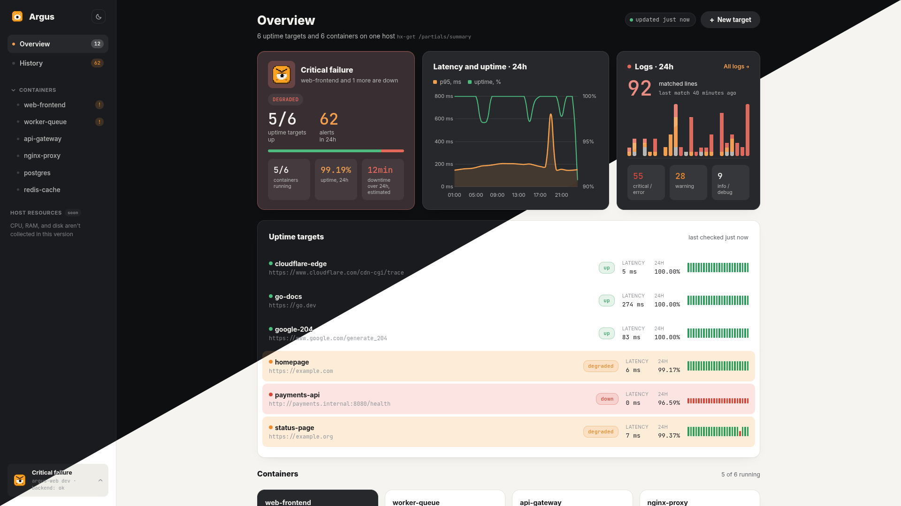

<div align="center">


# Argus

**Self-hosted uptime and Docker monitoring for a single host.**
Two small Go services, one Postgres, and a dashboard that refuses to make numbers up.

</div>



## What it is

Argus watches one machine and answers three questions: *is my service responding*, *are my containers staying up*, and *what happened while I wasn't looking*.

It is built for the case where Prometheus + Grafana + Alertmanager is three services too many — a single VPS running a handful of containers. You label the containers you care about, point Argus at a health-check URL, and get a dashboard plus Telegram alerts. No agents, no exporters, no query language.

Everything it knows comes from two sources: HTTP health checks it performs itself, and the Docker event stream. Nothing is inferred, sampled, or smoothed.


## The rule that shapes everything

**Only what is actually in the data reaches the screen.** A monitoring tool that shows a plausible number in place of a missing one is worse than a broken one, so Argus doesn't:

| Situation | What Argus shows | What it refuses to show |
| --- | --- | --- |
| An hour with no checks | a gap in the chart | a zero, drawn as if latency were 0 ms |
| A target that has never been checked | `—` | `100% uptime` |
| A container that went down, came back, but the return was never recorded | `return not recorded`, duration `—` | a downtime counter that keeps growing |
| An empty database | empty states in every block | demo numbers |

The same rule applies to sums: the outage summary adds up only the intervals it could actually measure, and says out loud how many it couldn't.

## How it works

```
    HTTP health checks            Docker event stream
    (GET, every 60s)              (die / oom / kill / restart / start / destroy)
            │                              │
            ▼                              ▼
    ┌──────────────────────────────────────────────────┐
    │  collector  (argus-backend)                      │
    │  prober · watcher · alerter · REST API :8099      │
    └──────────────────────────────────────────────────┘
            │                              │
            ▼                              ▼
       PostgreSQL                    Telegram bot
            │
            │  GET /v1/api/…  (read-only)
            ▼
    ┌──────────────────────────────────────────────────┐
    │  dashboard  (argus-frontend)  :8088              │
    │  htmx · Alpine · Chart.js on Go templates         │
    └──────────────────────────────────────────────────┘
```

**The collector** owns everything that writes. Its *prober* sends a `GET` to every probe target every 60 seconds and records latency and outcome; a response under HTTP 300 counts as up. Its *watcher* subscribes to the Docker event stream and records container lifecycle events as they happen — no polling, no missed restarts. Its *alerter* pushes new alerts to Telegram and marks them as sent.

**The dashboard** is a separate process that only reads, over the collector's own REST API. It holds no state, has no write endpoints, and can be restarted or rebuilt while the collector keeps recording. If the collector is down, the dashboard says so instead of showing stale numbers as if they were live.

The two processes share nothing but the API. Start them in any order.

## What you get

### Outage history with real durations

Argus doesn't store "incidents" — it reconstructs them on read from probe results and Docker events. A run of failed checks becomes one outage; a `die` closed by a `start` becomes one outage with a measured duration. One stop of a container is one outage, even though Docker reports it as a `kill` and a `die` a second apart.


### A per-container page that admits what it doesn't know

The 24-hour bar shows measured outages. Its background is deliberately neutral, not green: Docker only reports failures, so a quiet stretch means *no events were recorded*, which is not the same as proof the container was up. Below the bar, every outage is listed with its cause and duration, because a seven-minute outage is 0.5% of a day and unreadable on any bar.


Click a container in the sidebar and you land there. Containers that need attention sort above the calm ones.


### Alert history you can actually narrow down

Filter by target kind and severity. Filters are links, the list swaps in place, and an empty result says "no alerts match this filter" rather than pretending the history is empty.


### Charts that keep their gaps

Latency p95 and uptime across all probe targets, and Docker event counts per hour for a single container. The charts are the one part of the page htmx never replaces — points arrive as JSON and datasets update in place, so tooltips and animation survive.


### A mascot that tells you the mood before you read a number

<p>


</p>

Calm, watching, angry, asleep — derived from the same data as everything else. Asleep means the collector isn't answering, not that all is well.

### Details that matter at 3am

- **Live without reloads.** Every panel re-fetches itself every 10 seconds and swaps in place. A chip in the header shows the age of the data and pauses polling when you click it.
- **Only real changes flash.** A panel that swapped identical content stays still, so a blinking screen always means something actually changed.
- **Works offline.** htmx, Alpine, Chart.js and both fonts are vendored into the binary. The dashboard opens on a host with no internet.
- **Dark and light.** The theme is resolved by an inline script before first paint, so the page never flashes the wrong palette.
- **Honest failure.** When the collector is unreachable, pages show a waiting screen and panels keep the last live data on screen instead of blanking out.

## Getting started

### 1. Start the collector

```bash
cd argus-backend
cp .example.env .env      # Postgres credentials, Telegram token and chat id
docker compose up -d      # Postgres 16 + goose migrations + collector on :8099
```

The collector needs `/var/run/docker.sock` mounted to watch containers — the compose file does this. Without Telegram configured it still records everything; it just doesn't notify.

### 2. Start the dashboard

```bash
cd argus-frontend
export ARGUS_BACKEND_URL=http://localhost:8099
go run ./cmd/web -config config.yaml    # dashboard on :8088
```

### 3. Tell Argus what to watch

Label the containers you care about:

```yaml
services:
  web:
    image: my-app
    labels:
      argus.monitor: "true"                        # watch this container's lifecycle
      argus.probe.url: "http://web:8080/health"    # and health-check this URL
```

| Label | Effect |
| --- | --- |
| `argus.monitor: "true"` | Registers the container. Its `die` / `oom` / `kill` / `restart` / `start` / `destroy` events are recorded from then on. |
| `argus.probe.url: <url>` | Also registers an HTTP probe target, checked every 60 seconds. Optional. |

The watcher picks up labelled containers as they start — no restart of Argus needed.

## Alerts


Alerts are raised by the collector and delivered by the Telegram bot (`/start` it once to receive them). Every row says whether it actually reached Telegram — the dashboard reports delivery, it doesn't assume it.

| What happened | Severity | Notifies |
| --- | --- | --- |
| Container hit an OOM kill | `critical` | yes |
| Container exited with a non-zero code | `error` | yes |
| Health check failed, timed out, or returned ≥ 300 | `error` | yes |
| Container exited cleanly (code 0) | `info` | no |
| `kill` / `restart` / `start` / `destroy` | `info` | no |

Failures come with a readable reason rather than a raw Go error — `Health check timed out`, `Health check returned HTTP 502`.

## Configuration

**Collector** — `argus-backend/config.yaml`:

| Key | Default | Meaning |
| --- | --- | --- |
| `http_server.addr` | `0.0.0.0:8099` | where the REST API listens |
| `prober.probe_interval` | `60s` | how often probe targets are checked |
| `prober.probe_timeout` | `5s` | per-check timeout |
| `telegram.notify_interval` | `5s` | how often pending alerts are pushed |

**Dashboard** — `argus-frontend/config.yaml`:

| Key | Default | Meaning |
| --- | --- | --- |
| `backend.base_url` | — | collector address, required |
| `backend.timeout_seconds` | `5` | per-request timeout to the collector |
| `web.listen_addr` | `:8080` | where the dashboard listens (this repo's config sets `:8088`) |
| `web.template_dir` | empty | set to `./web` to load templates and CSS from disk during development |
| `web.retention_days` | `14` | used only to explain an empty alert history on screen |

## Deliberately not in this version

Named here because a monitoring tool that hides its blind spots is the problem it claims to solve:

- **No CPU, RAM or disk**, for the host or for containers. Nothing collects them, so the dashboard shows a note instead of an empty gauge.
- **No alert lifecycle.** There is no acknowledge or resolve — only "sent to Telegram". The screen says exactly that.
- **No latency for containers.** Nothing pings a container, so its page shows Docker event activity instead of a made-up response time.
- **No automatic pruning.** The queries to delete old probes and events exist, but nothing schedules them yet.
- **One host.** No clustering, no federation, no remote agents.

## Under the hood

Two Go modules, clean architecture in both, no framework in either.

```
argus-backend/     collector: prober, watcher, alerter, REST API
  internal/domain/entity        domain types
  internal/usecase              business logic, repository ports
  internal/storage              PostgreSQL (pgx)
  internal/transport/http       chi router, handlers, swagger
  migrations/                   goose

argus-frontend/    dashboard: read-only
  internal/domain/entity        domain types, no dependencies
  internal/usecase              aggregation: uptime, outages, p95
  internal/gateway/backend      HTTP client to the collector
  internal/transport/http       router, handlers, presenter, templates
  web/                          templates and static assets, go:embed
```

Ports are declared by the consumer, so dependencies point inward: the aggregation layer knows nothing about HTTP, and the domain layer knows nothing about HTTP or HTML. The dashboard connects over the API only — it has no database driver at all. Its entire dependency list is a YAML parser; everything else is the standard library.

Stack: Go, PostgreSQL 16, htmx, Alpine.js, Chart.js, raw CSS. No SPA framework, no build pipeline, no CDN.
